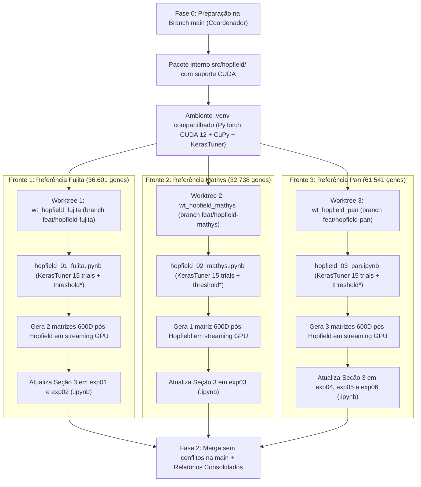
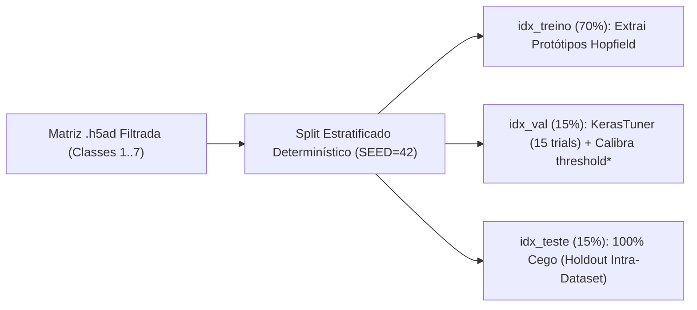

# Plano de Implementação (Fase 2): Reconstrução de Genes Faltantes via Modern Hopfield Network (GPU) + SWeeP 600D + MLP

> [!IMPORTANT]
> **Objetivo Científico Central:** Na Fase 1, comprovamos empiricamente que substituir genes ausentes pelo valor sentinela neutro `0,5` degrada severamente o classificador celular MLP treinado em projeções SWeeP 600D (quedas de até **-21,40 p.p.** em acurácia e **-44,53 p.p.** em Macro F1). Nesta **Fase 2**, validaremos a tese central do mestrado de Leticia Astolpho Silvano: utilizar uma **Modern Hopfield Network** acelerada em GPU para inferir e substituir exclusivamente os valores `0,5` por estados transcricionais binários `{0, 1}` reconstruídos antes da projeção SWeeP 600D, medindo o ganho de recuperação do MLP exatamente sobre os mesmos modelos `.keras` e scalers `.pkl` da Fase 1.

---

## 1. Visão Geral da Arquitetura e Divisão em 3 Frentes Paralelas

Cada classificador MLP opera no espaço canônico de genes do seu **dataset de referência (treino)**. Portanto, treinaremos exatamente **3 redes Hopfield**, isoladas em **3 Git Worktrees paralelos** sem qualquer interseção de arquivos editados:



### Mapeamento Completo das 3 Frentes e Artefatos Exclusivos

| Frente / Worktree | Referência (Genes / Células Válidas) | Ortobase Canônica Obrigatoriamente Reutilizada | Checkpoint Hopfield Gerado | Projeções 600D Pós-Hopfield Geradas (`dados/`) | Notebooks Criados / Atualizados |
| :--- | :--- | :--- | :--- | :--- | :--- |
| **Frente 1** (`wt_hopfield_fujita`) | **Fujita** (`36.601` genes / `26.763` cél.) | `dados/fujita/orthbase_fujita_600d.npy` | `dados/fujita/hopfield/hopfield_fujita.pt` e `.json` | • `dados/fujita/X_fujita_pos_hopfield_600d.npy` `(26763, 600)`<br>• `dados/mathys/X_mathys_alinhado_fujita_pos_hopfield_600d.npy` `(45572, 600)` | • Novo: `experimentos_hopfield/hopfield_01_fujita.ipynb`<br>• Atualiza: `experimentos/exp01_fujita_para_fujita.ipynb`<br>• Atualiza: `experimentos/exp02_fujita_para_mathys.ipynb` |
| **Frente 2** (`wt_hopfield_mathys`) | **Mathys** (`32.738` genes / `45.572` cél.) | `dados/mathys/orthbase_mathys_600d.npy` | `dados/mathys/hopfield/hopfield_mathys.pt` e `.json` | • `dados/mathys/X_mathys_pos_hopfield_600d.npy` `(45572, 600)` | • Novo: `experimentos_hopfield/hopfield_02_mathys.ipynb`<br>• Atualiza: `experimentos/exp03_mathys_para_mathys.ipynb` |
| **Frente 3** (`wt_hopfield_pan`) | **Pan** (`61.541` genes / `57.457` cél.) | `dados/pan/orthbase_pan_600d.npy` | `dados/pan/hopfield/hopfield_pan.pt` e `.json` | • `dados/pan/X_pan_pos_hopfield_600d.npy` `(57457, 600)`<br>• `dados/fujita/X_fujita_alinhado_pan_pos_hopfield_600d.npy` `(26763, 600)`<br>• `dados/mathys/X_mathys_alinhado_pan_pos_hopfield_600d.npy` `(45572, 600)` | • Novo: `experimentos_hopfield/hopfield_03_pan.ipynb`<br>• Atualiza: `experimentos/exp04_pan_para_pan.ipynb`<br>• Atualiza: `experimentos/exp05_pan_para_fujita.ipynb`<br>• Atualiza: `experimentos/exp06_pan_para_mathys.ipynb` |

---

## 2. Regras Inegociáveis de Hardware, Disco e Rigor Metodológico

> [!CAUTION]
> **Restrições Críticas da Máquina Local (Obrigatórias para todos os Subagentes):**
> - **CPU:** Intel Core i5-7600 (4 núcleos físicos / 4 threads). Todo script e notebook DEVE definir no topo antes de importar bibliotecas numéricas:
>   `OMP_NUM_THREADS=1`, `OPENBLAS_NUM_THREADS=1`, `MKL_NUM_THREADS=1` e `torch.set_num_threads(1)`. Isso garante 1 núcleo por subagente paralelo + 1 núcleo livre para o SO.
> - **RAM:** 16 GB DDR4. **É TERMINANTEMENTE PROIBIDO** chamar `.toarray()` ou `np.asarray()` sobre matrizes globais `N_células × N_genes`. As matrizes binárias `W0` DEVEM permanecer como `scipy.sparse.csr_matrix` (`float32`), ocupando menos de 900 MB por dataset.
> - **Disco Livre:** Apenas **~20 GB livres** em `/dev/nvme0n1p1`.
>   1. **PROIBIDO** criar novos `.venv` ou copiar a pasta `dados/` (6,4 GB) nos worktrees — usar exclusivamente `ln -s` (symlinks).
>   2. **PROIBIDO** salvar matrizes densas `N_células × N_genes` imputadas em `.npy` ou `.mtx` no disco (uma matriz densa do Pan ocupa `14,14 GB`!). A reconstrução Hopfield e a projeção `sweep.sweep` DEVEM ocorrer em **streaming na memória da GPU em lotes de `2.048` células**, salvando em disco apenas o resultado projetado de `600` colunas (`62 MB` a `132 MB`).
> - **GPU:** NVIDIA RTX 3060 (12 GB VRAM, ~11,3 GB livres).
>   1. `ModernHopfieldNetwork` e `sweep.sweep` rodam na GPU (`device="cuda"`).
>   2. Nos notebooks/scripts que importam `tensorflow` para rodar o MLP, declarar **imediatamente após `import tensorflow as tf`**:
>      `tf.config.set_visible_devices([], "GPU")` — impede que o TensorFlow aloque silenciosamente quase toda a VRAM da RTX 3060 e derrube o CuPy/PyTorch dos outros subagentes!

### Garantias Metodológicas (Zero Vazamento + Comparação 100% Pareada)



1. **Particionamento Idêntico à Fase 1 (`SEED = 42`):**
   Para garantir zero vazamento de dados nos experimentos intra-dataset (`Exp 01`, `Exp 03`, `Exp 04`), a divisão de células DEVE usar exatamente a mesma função da Fase 1:
   ```python
   indices = np.arange(len(y_ref))
   idx_treino_val, idx_teste = train_test_split(
       indices, test_size=0.15, random_state=42, stratify=y_ref
   )
   razao_val = 0.15 / (1.0 - 0.15)
   idx_treino, idx_val = train_test_split(
       idx_treino_val, test_size=razao_val, random_state=42, stratify=y_ref[idx_treino_val]
   )
   ```
   *(Atenção: em `y_<dataset>.npy`, os rótulos já estão codificados de `0` a `6`, correspondendo às classes biológicas `1` a `7`. Na Hopfield, usar `y_ref_1a7 = y_ref + 1` para manter compatibilidade total com `CLASSES_CANONICAS = [1, 2, 3, 4, 5, 6, 7]`).*
2. **Reuso Estrito do SWeeP Oficial (`AGENTS.md`):**
   Sempre projetar com `sweep.sweep(input=bloco, orthbase=orthbase_ref, device="cuda", dtype=np.float32, verbose=False)` usando a `orthbase_<ref>_600d.npy` congelada da referência. Jamais usar multiplicação matricial manual.
3. **Reuso Estrito dos Pesos `.keras` e `.pkl` da Fase 1:**
   Nos notebooks `exp01`..`exp06`, a nova Seção 3 DEVE carregar `modelo_mlp_exp0*.keras` e `scaler_exp0*.pkl` já salvos na Fase 1, sem retreinar o MLP.

---

## 3. Especificação Técnica Detalhada por Fase (Guia Passo a Passo)

### Fase 0: Infraestrutura Base na `main` (Executada pelo Coordenador antes dos Worktrees)

#### Passo 0.1 — Higiene de Espaço em Disco e Instalação de `torch` CUDA + `keras-tuner`
1. Checar espaço livre em `/` com `df -h /`. Caso haja menos de `10 GB` livres, executar `uv cache prune` (limpa wheels antigas órfãs em `~/.cache/uv` sem afetar nenhum `.venv`).
2. No diretório `/home/rasert/workspace/Teste_MlP_fujita_para_fujitafaltante_fujitapos_imputacao`, instalar `torch` compatível com as bibliotecas CUDA 12 já presentes no ambiente (`cupy-cuda12x`) e `keras-tuner`:
   - Configurar no `pyproject.toml` o índice oficial PyTorch CUDA 12 (`https://download.pytorch.org/whl/cu126`) para `torch` e adicionar `torch>=2.4.0` e `keras-tuner>=1.4.8` via `uv`.
3. Executar comando de validação conjunta de GPU (Critério de Aceite Obrigatório):
   ```bash
   uv run python -c "import torch, sweep, cupy as cp; assert torch.cuda.is_available(); assert sweep.is_gpu_available(); print('PyTorch GPU:', torch.cuda.get_device_name(0), '| SWeeP GPU:', sweep.get_gpu_device_name())"
   ```

#### Passo 0.2 — Criação do Pacote Autocontido `src/hopfield/` com Aceleração GPU
Copiar os módulos essenciais de `/home/rasert/workspace/pipiline_hopifield/src/treinamento/` para `/home/rasert/workspace/Teste_MlP_fujita_para_fujitafaltante_fujitapos_imputacao/src/hopfield/` (**sem modificar nada no repositório `pipiline_hopifield`**):

- `src/hopfield/__init__.py`
- `src/hopfield/hopfield_utils.py` (copiado de `hopfield_utils.py`)
- `src/hopfield/estrategias_clusterizacao.py` (copiado de `estrategias_clusterizacao.py`)
- `src/hopfield/extrator_padroes.py` (copiado de `extrator_padroes.py`)
- `src/hopfield/avaliador_hopfield.py` (copiado de `avaliador_hopfield.py`)
- `src/hopfield/hopfield.py` (**adaptado para GPU CUDA**, especificações abaixo)
- `src/hopfield/hopfield_kerastuner.py` (importando dos módulos locais `.hopfield`, `.extrator_padroes`, etc., com `device` automático)
- `src/hopfield/pipeline_imputacao.py` (**novo módulo utilitário padronizado** com funções determinísticas compartilhadas pelas 3 frentes — reduz drasticamente a chance de erro dos subagentes!)

##### Especificação Exata da Adaptação GPU em `src/hopfield/hopfield.py`:
1. No `__init__`, adicionar parâmetro `device: str | torch.device | None = None`:
   ```python
   if device is None:
       self.device = torch.device("cuda" if torch.cuda.is_available() else "cpu")
   else:
       self.device = torch.device(device)
   ```
2. Em `store(self, patterns)`:
   Enviar `self.patterns = K.to(self.device)` (ocupa apenas 32 MB a 60 MB de VRAM para 245 padrões × 61.541 genes em `float32`).
3. Em `retrieve(...)` e `compute_attention_weights(...)`:
   - Manter `Xi = self.patterns.to(dtype=torch.float32, device=self.device)` na GPU durante o loop de lotes (`batch_size = 2048`).
   - Em cada iteração `for s in range(0, n_queries, batch_size):`:
     - Extrair `chunk_np` em CPU (`CSR[s:s+batch_size].toarray().astype(np.float32)`).
     - Se `mask_sentinela_ausentes is not None`, aplicar `chunk_np[:, mask_sentinela_ausentes] = fill_value`.
     - Transferir **apenas o lote** para a GPU: `x = torch.from_numpy(chunk_np).to(device=self.device)`.
     - Executar toda a dinâmica de atenção (`2.0 * x - 1.0`, `F.normalize` ou escala `1/sqrt(D)`, `x_att @ Xi_att.T`, `torch.softmax`, `weights @ Xi`, cálculo de `p_tensor` e limiar `x > self.threshold`) **inteiramente na GPU**.
     - Copiar o resultado do lote de volta para os buffers NumPy em CPU (`.detach().cpu().numpy()`) e liberar tensores temporários do lote.
   - Ao sair do loop, se `self.device.type == "cuda"`, chamar `torch.cuda.empty_cache()`.
4. Em `salvar(self, path)` e `carregar(cls, path, device=None)`:
   - Sempre salvar `"patterns": self.patterns.detach().cpu()` no `.pt` para portabilidade total; em `carregar`, mover `rede.patterns = data["patterns"].to(rede.device)`.

##### Especificação Exata do Módulo `src/hopfield/pipeline_imputacao.py`:
Para que modelos menores não precisem reimplementar matemática delicada em cada worktree, este módulo fornecerá 5 funções prontas, tipadas e testadas:

1. `carregar_matriz_binaria_csr(path_h5ad: Path, path_labels: Path, classes_validas: list[int] = [1,2,3,4,5,6,7]) -> tuple[sp.csr_matrix, np.ndarray]`:
   - Usa um lock leve de arquivo (`fcntl.flock` em `/tmp/hopfield_h5ad_io.lock`) **apenas** durante os ~5 segundos de `ad.read_h5ad()` + fatiamento `adata.X[mascara].tocsr()` + `del adata; gc.collect()`, impedindo que os 3 subagentes descompactem arquivos `.h5ad` de 2 GB no mesmo segundo na RAM de 16 GB.
   - Binariza estritamente (`X.eliminate_zeros(); X.data = np.ones_like(X.data, dtype=np.float32)`) e retorna `(X_csr, y_0a6)`.
2. `obter_particoes_canonicas(y_0a6: np.ndarray, seed: int = 42) -> tuple[np.ndarray, np.ndarray, np.ndarray]`:
   - Retorna exatamente `(idx_treino, idx_val, idx_teste)` idênticos aos da Fase 1.
3. `calibrar_limiar_otimo_pr(rede: ModernHopfieldNetwork, X_val_csr: sp.csr_matrix, mask_genes_ocultos: np.ndarray, batch_size: int = 2048) -> dict[str, Any]`:
   - Implementa a calibração do **ADR 027** sem vazamento:
     - Toma `X_val_csr` (`15%` de validação da referência, onde os valores reais `{0, 1}` das colunas `mask_genes_ocultos` são conhecidos!).
     - Passa `X_val_csr` em `rede.retrieve(..., mask_sentinela_ausentes=mask_genes_ocultos, fill_value=0.5, return_probabilities=True, batch_size=batch_size)` obtendo `Wprob_val`.
     - Extrai `y_true_genes = X_val_csr[:, mask_genes_ocultos].toarray().ravel()` e `y_prob_genes = Wprob_val[:, mask_genes_ocultos].ravel()`.
     - *(Se `len(y_true_genes) > 20_000_000`, amostra deterministicamente `20_000_000` coordenadas com `rng = np.random.default_rng(42)` para cálculo instantâneo da curva PR em < 1s e < 200 MB RAM).*
     - Calcula `precision, recall, thresholds = precision_recall_curve(y_true_genes, y_prob_genes)` e `f1_pts = (2 * precision[:-1] * recall[:-1]) / np.maximum(precision[:-1] + recall[:-1], 1e-9)`.
     - Encontra `threshold_prob_otimo = float(thresholds[np.argmax(f1_pts)])`.
     - **Conversão explícita para o espaço bipolar da `ModernHopfieldNetwork` (`[-1, +1]`):**
       Como `p = (x_bipolar + 1.0) / 2.0`, atualiza `rede.threshold = float(2.0 * threshold_prob_otimo - 1.0)`!
     - Retorna dicionário com `threshold_prob_otimo`, `threshold_bipolar_otimo`, `melhor_f1_gene`, `precisao_otima`, `recall_otimo`, e vetores compactos downsampled (`200` pontos) de `precision` e `recall` para plotagem leve em Plotly!
4. `imputar_e_projetar_sweep_streaming(rede: ModernHopfieldNetwork, X_alvo_csr: sp.csr_matrix, genes_alvo: list[str], genes_ref: list[str], orthbase_ref: np.ndarray, threshold_prob_otimo: float, mask_forcar_sentinela_ref: np.ndarray | None = None, chunk_size: int = 2048) -> tuple[np.ndarray, dict[str, Any]]`:
   - Suporta **ambos** os casos (Intra-Dataset onde `genes_alvo == genes_ref` com `mask_forcar_sentinela_ref`, e Cross-Dataset onde `genes_alvo != genes_ref` mapeando Ensembl IDs comuns e marcando ausentes com `0.5`).
   - Em cada bloco `ini:fim` de `chunk_size = 2048` células:
     1. Constrói `bloco_entrada` `(B, n_genes_ref)` em `float32`: colunas presentes recebem os `{0, 1}` reais de `X_alvo_csr[ini:fim]`; colunas em `mask_ausentes` recebem `0.5`.
     2. Chama `_, prob_bloco = rede.retrieve(bloco_entrada, batch_size=chunk_size, return_probabilities=True)`.
     3. Reconstrói **exclusivamente** as colunas sentinela:
        `imputado_bin = (prob_bloco[:, mask_ausentes] >= threshold_prob_otimo).astype(np.float32)`
        `bloco_reconstruido = bloco_entrada.copy()`
        `bloco_reconstruido[:, mask_ausentes] = imputado_bin`
     4. Verifica com `assert not np.any(np.isclose(bloco_reconstruido, 0.5))` que **100% dos sentinelas `0,5` foram eliminados** e com `assert np.all((bloco_reconstruido == 0.0) | (bloco_reconstruido == 1.0))` que a matriz é estritamente binária `{0, 1}`!
     5. Libera cache temporário PyTorch e projeta o bloco via pacote oficial:
        `res = sweep.sweep(input=bloco_reconstruido, orthbase=orthbase_ref, device="cuda", dtype=np.float32, verbose=False)`
     6. Acumula `res.proj.astype(np.float32)` `(B, 600)`.
   - Ao final, libera `cp.get_default_memory_pool().free_all_blocks()` e `torch.cuda.empty_cache()`, retornando `(X_pos_hopfield_600d, estatisticas_imputacao)` (total de coordenadas imputadas, % de `1`s ativados e % de `0`s inativados).
5. `anexar_secao_pos_hopfield_notebook(...)`:
   - Utilitário seguro baseado em `nbformat` + `nbclient` que:
     - Verifica se o notebook `exp0X_*.ipynb` já possui a Seção 3 (idempotência: substitui caso reexecutado, sem duplicar células);
     - Garante na célula de treino do MLP (Seção 1) guarda defensiva `FORCAR_RETREINO_MLP = False` para reuso futuro no JupyterLab;
     - Carrega os outputs existentes das Seções 1 e 2 **sem reexecutar o treinamento do MLP**, ou executa o notebook preservando os pesos salvos `modelo_mlp_exp0X_*.keras` e `scaler_exp0X.pkl`, gerando todos os gráficos Plotly interativos da Seção 3!

#### Passo 0.3 — Teste Unitário Rápido, Commit Base e Criação dos 3 Git Worktrees
1. Executar um teste de fumaça rápido (`tests/test_hopfield_gpu.py`) validando:
   - `ModernHopfieldNetwork` na GPU (`device="cuda"`),
   - equivalência exata entre `threshold_prob_otimo` e `threshold_bipolar_otimo`,
   - substituição estrita apenas de `mask_ausentes` sem tocar nos genes reais medidos,
   - projeção `sweep.sweep` na GPU.
2. Atualizar `.gitignore` adicionando `outputs_kt_*/` (logs temporários de trials do KerasTuner) mantendo os `.pt` e `.json` em `dados/*/hopfield/` (que já fica em `dados/` compartilhado).
3. Fazer commit na `main` (`feat(hopfield): adicionar pacote src/hopfield acelerado em GPU e utilitarios de streaming`).
4. Criar os **3 Git Worktrees** com symlinks de zero custo de disco:
   ```bash
   REPO="/home/rasert/workspace/Teste_MlP_fujita_para_fujitafaltante_fujitapos_imputacao"
   git -C "$REPO" worktree add -b feat/hopfield-fujita /home/rasert/workspace/wt_hopfield_fujita main
   git -C "$REPO" worktree add -b feat/hopfield-mathys /home/rasert/workspace/wt_hopfield_mathys main
   git -C "$REPO" worktree add -b feat/hopfield-pan    /home/rasert/workspace/wt_hopfield_pan    main

   for WT in /home/rasert/workspace/wt_hopfield_fujita /home/rasert/workspace/wt_hopfield_mathys /home/rasert/workspace/wt_hopfield_pan; do
       rm -rf "$WT/dados" "$WT/.venv"
       ln -s "$REPO/dados" "$WT/dados"
       ln -s "$REPO/.venv" "$WT/.venv"
   done
   ```

---

### Fase 1: Execução Paralela pelos 3 Subagentes (1 por Git Worktree)

Cada subagente trabalhará **estritamente dentro do seu diretório de worktree**, sem jamais tocar nos arquivos das outras duas frentes.

#### Subagente 1 — Frente Fujita (`/home/rasert/workspace/wt_hopfield_fujita` | branch `feat/hopfield-fujita`)
1. **Script/Notebook de Treino e Imputação (`experimentos_hopfield/hopfield_01_fujita.ipynb`):**
   - Carrega Fujita (`matrizFiltradaeNormalizadaF (1).h5ad`, `cell_types_binarioF.txt`, `featuresF.tsv`), `X_fujita_600d.npy`, `orthbase_fujita_600d.npy` e `y_fujita.npy`.
   - Particiona com `obter_particoes_canonicas(y_fujita, seed=42)`: `18.734` treino / `4.014` val / `4.015` teste.
   - Roda `HopfieldKerasTuner` (`max_trials=15`, `algorithm="bayesian"`, `objective="val_f1_macro"`, `seed=42`, `directory="/tmp/kt_fujita"`) sobre `W0_train` + `Wswp_train` avaliando em `W0_val`.
   - Constrói `rede_fujita` campeã e plota o **Gráfico 1: Convergência Bayesiana dos 15 Trials (Plotly)**.
   - Calibra `threshold_prob_otimo` via `calibrar_limiar_otimo_pr` em `W0_val` ocultando as `6.376` colunas de `G_Fujita \ (G_Pan ∩ G_Fujita ∩ G_Mathys)` e plota o **Gráfico 2: Curva Precision-Recall e Limiar Ótimo `threshold*` (Plotly)**.
   - Avalia a própria Hopfield no holdout cego `W0_test` (`4.015` células) via *Softmax Class Pooling* e plota o **Gráfico 3: Matriz de Confusão Holdout da Rede Hopfield Fujita (Plotly)**.
   - Salva `dados/fujita/hopfield/hopfield_fujita.pt` e `dados/fujita/hopfield/hopfield_fujita_meta.json` (incluindo `threshold_prob_otimo` e métricas de calibração).
   - Gera em streaming GPU as **2 projeções 600D pós-Hopfield**:
     1. `dados/fujita/X_fujita_pos_hopfield_600d.npy` `(26763, 600)` — substituindo as `6.376` colunas de ruído intra-dataset.
     2. `dados/mathys/X_mathys_alinhado_fujita_pos_hopfield_600d.npy` `(45572, 600)` — alinhando Mathys às `36.601` colunas do Fujita, reconstruindo as `6.305` colunas ausentes e projetando com `orthbase_fujita_600d.npy`.
   - Executa o notebook `experimentos_hopfield/hopfield_01_fujita.ipynb` completo com outputs salvos.
2. **Atualização dos Notebooks do MLP (`exp01` e `exp02`):**
   - Em `experimentos/exp01_fujita_para_fujita.ipynb`: adiciona **Seção 8 — Avaliação Pós-Imputação Hopfield**, carregando `modelo_mlp_exp01_fujita_para_fujita.keras`, `scaler_exp01.pkl` e `X_fujita_pos_hopfield_600d.npy`, avaliando no **mesmo `idx_teste` (15% cego)** e no dataset completo, plotando:
     - **Matriz de Confusão Pós-Hopfield (Plotly)**;
     - **Gráfico de Barras Triplo (Plotly):** *Baseline Limpo (`#2ca02c`)* vs. *Com Ruído 0,5 (`#d62728`)* vs. *Pós-Imputação Hopfield (`#1f77b4`)* para Acurácia, Macro F1, Weighted F1 e F1 das Classes 1 a 7;
     - Resumo numérico de recuperação (`Δ Pós-Hopfield vs. Ruído 0,5` em p.p. e `% da perda recuperada`), salvando `dados/fujita/metricas_comparativas_exp01.json`.
   - Em `experimentos/exp02_fujita_para_mathys.ipynb`: adiciona **Seção 8 — Avaliação Cross-Dataset Pós-Imputação Hopfield**, carregando `modelo_mlp_exp02_fujita_para_mathys.keras`, `scaler_exp02.pkl` e `X_mathys_alinhado_fujita_pos_hopfield_600d.npy`, avaliando nas `45.572` células do Mathys, gerando a Matriz de Confusão Pós-Hopfield, o Gráfico de Barras Triplo e salvando `dados/fujita/metricas_comparativas_exp02.json`.
3. **Commit na Branch `feat/hopfield-fujita`:**
   - Verifica `git status` garantindo que apenas `experimentos_hopfield/hopfield_01_fujita.ipynb`, `experimentos/exp01_fujita_para_fujita.ipynb`, `experimentos/exp02_fujita_para_mathys.ipynb` (e eventual script auxiliar próprio `scripts/frente_fujita.py`) foram adicionados/modificados, e realiza commit.

#### Subagente 2 — Frente Mathys (`/home/rasert/workspace/wt_hopfield_mathys` | branch `feat/hopfield-mathys`)
1. **Script/Notebook de Treino e Imputação (`experimentos_hopfield/hopfield_02_mathys.ipynb`):**
   - Carrega Mathys (`matriz_anotada_finalM.h5ad`, `tipos_celulares_numericoMs.txt`, `featuresM.tsv`), `X_mathys_600d.npy`, `orthbase_mathys_600d.npy` e `y_mathys.npy`.
   - Particiona com `obter_particoes_canonicas(y_mathys, seed=42)`: `31.900` treino / `6.836` val / `6.836` teste.
   - Roda `HopfieldKerasTuner` (`max_trials=15`, `directory="/tmp/kt_mathys"`), constrói `rede_mathys` campeã, calibra `threshold_prob_otimo` em `W0_val` ocultando as `2.513` colunas de `G_Mathys \ s_triple`, plota os 3 gráficos diagnósticos da Hopfield e salva `dados/mathys/hopfield/hopfield_mathys.pt` e `.json`.
   - Gera em streaming GPU:
     - `dados/mathys/X_mathys_pos_hopfield_600d.npy` `(45572, 600)` com `orthbase_mathys_600d.npy`.
2. **Atualização do Notebook do MLP (`exp03`):**
   - Em `experimentos/exp03_mathys_para_mathys.ipynb`: adiciona **Seção 8 — Avaliação Pós-Imputação Hopfield** usando `modelo_mlp_exp03_mathys_para_mathys.keras`, `scaler_exp03.pkl` e `X_mathys_pos_hopfield_600d.npy` no `idx_teste` cego (`6.836` células) e dataset completo, gerando Matriz de Confusão Pós-Hopfield, Gráfico de Barras Triplo e `dados/mathys/metricas_comparativas_exp03.json`.
3. **Commit na Branch `feat/hopfield-mathys`:**
   - Verifica isolamento de arquivos e realiza commit.

#### Subagente 3 — Frente Pan (`/home/rasert/workspace/wt_hopfield_pan` | branch `feat/hopfield-pan`)
1. **Script/Notebook de Treino e Imputação (`experimentos_hopfield/hopfield_03_pan.ipynb`):**
   - Carrega Pan (`pan_anotado.h5ad`, `PanNumerico.csv`, `featuresPANcorrigido.tsv`), `X_pan_600d.npy`, `orthbase_pan_600d.npy` e `y_pan.npy`.
   - Particiona com `obter_particoes_canonicas(y_pan, seed=42)`: `40.219` treino / `8.619` val / `8.619` teste.
   - Roda `HopfieldKerasTuner` (`max_trials=15`, `directory="/tmp/kt_pan"`), constrói `rede_pan` campeã, calibra `threshold_prob_otimo` em `W0_val` ocultando as `31.316` colunas de `G_Pan \ s_triple`, plota os 3 gráficos diagnósticos da Hopfield e salva `dados/pan/hopfield/hopfield_pan.pt` e `.json`.
   - Gera em streaming GPU as **3 projeções 600D pós-Hopfield** (todas com `orthbase_pan_600d.npy`):
     1. `dados/pan/X_pan_pos_hopfield_600d.npy` `(57457, 600)` — `31.316` colunas reconstruídas (Exp 04).
     2. `dados/fujita/X_fujita_alinhado_pan_pos_hopfield_600d.npy` `(26763, 600)` — `25.065` colunas ausentes no Fujita reconstruídas no espaço de `61.541` genes do Pan (Exp 05).
     3. `dados/mathys/X_mathys_alinhado_pan_pos_hopfield_600d.npy` `(45572, 600)` — `30.705` colunas ausentes no Mathys reconstruídas no espaço de `61.541` genes do Pan (Exp 06).
2. **Atualização dos Notebooks do MLP (`exp04`, `exp05` e `exp06`):**
   - Atualiza `experimentos/exp04_pan_para_pan.ipynb`, `experimentos/exp05_pan_para_fujita.ipynb` e `experimentos/exp06_pan_para_mathys.ipynb` com a **Seção 8 — Avaliação Pós-Imputação Hopfield**, reutilizando `modelo_mlp_exp04..06_*.keras` e `scaler_exp04..06.pkl`, gerando Matriz de Confusão Pós-Hopfield, Gráfico de Barras Triplo e `dados/pan/metricas_comparativas_exp04..06.json`.
3. **Commit na Branch `feat/hopfield-pan`:**
   - Verifica isolamento de arquivos e realiza commit.

---

### Fase 2: Merge, Verificação Final e Documentação Científica Consolidada (Coordenador)

1. **Merge Limpo e Limpeza de Worktrees:**
   - Remover os symlinks não rastreados temporários e executar na raiz `main`:
     ```bash
     git merge --no-ff feat/hopfield-fujita -m "feat(fujita): concluir treino Hopfield GPU e avaliacao pos-imputacao exp01 e exp02"
     git merge --no-ff feat/hopfield-mathys -m "feat(mathys): concluir treino Hopfield GPU e avaliacao pos-imputacao exp03"
     git merge --no-ff feat/hopfield-pan    -m "feat(pan): concluir treino Hopfield GPU e avaliacao pos-imputacao exp04, exp05 e exp06"
     git worktree remove /home/rasert/workspace/wt_hopfield_fujita
     git worktree remove /home/rasert/workspace/wt_hopfield_mathys
     git worktree remove /home/rasert/workspace/wt_hopfield_pan
     git branch -d feat/hopfield-fujita feat/hopfield-mathys feat/hopfield-pan
     rm -rf /tmp/kt_fujita /tmp/kt_mathys /tmp/kt_pan
     ```
2. **Checklist de Verificação Determinística (Critérios de Aceite):**
   - [ ] Os 3 checkpoints `.pt`/`.json` e as 6 matrizes `*_pos_hopfield_600d.npy` existem em `dados/`, não contêm `NaN`/`Inf` e têm shapes exatos `(N_células, 600)`.
   - [ ] Os 3 notebooks em `experimentos_hopfield/` e os 6 notebooks em `experimentos/` possuem células executadas sem exceções e gráficos Plotly renderizados.
   - [ ] Os 6 arquivos `metricas_comparativas_exp01..06.json` registram lado a lado: *Baseline Limpo*, *Com Ruído 0,5* e *Pós-Imputação Hopfield* (Acurácia, Macro F1, Weighted F1 e F1 por classe celular 1..7).
   - [ ] `ruff check src/` passa sem erros e o espaço livre em disco permanece seguro (> 15 GB livres).
3. **Persistência da Documentação Científica nos Dois Repositórios:**
   - **No repositório `Teste_MlP_fujita_para_fujitafaltante_fujitapos_imputacao/docs/`:**
     - `docs/plano_fase2_imputacao_hopfield.md` (este plano técnico completo)
     - `docs/relatorio_resultados_pos_hopfield.md` (relatório executivo consolidando a tabela comparativa tripla dos 6 experimentos, hiperparâmetros campeões das 3 redes Hopfield, recuperação das classes críticas como a Classe 5 e Classe 2 no `Pan -> Mathys`, e conclusão formal sobre a eficácia da proposta de mestrado da Leticia).
   - **No Second Brain da Leticia (`/home/rasert/workspace/pipiline_hopifield/second_brain/01_Projetos/validacao_ruido_mlp_sweep/`):**
     - `plano_fase2_imputacao_hopfield.md` e `relatorio_resultados_pos_hopfield.md` (seguindo estritamente as regras locais de `pipiline_hopifield/AGENTS.md`: cabeçalho YAML OKF com `tipo:`, conexões `[[Wikilinks]]`, diagramas Mermaid e **zero sintaxe LaTeX `$...$`**), atualizando `index.md` da pasta.
