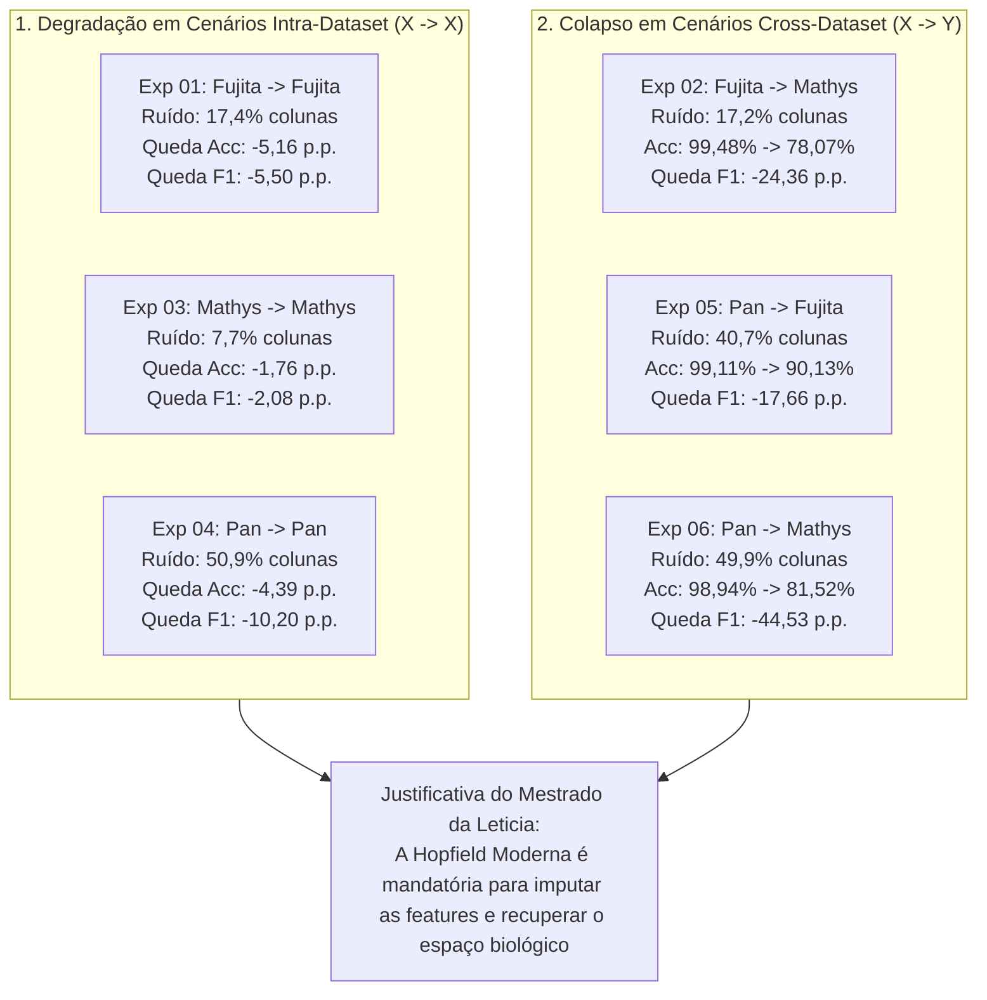

# Relatório de Execução e Resultados: Sensibilidade ao Ruído (Sentinela 0,5) no MLP com SWeeP 600D

## 1. Veredito Científico Executivo

A implementação e execução da bateria de **6 experimentos** desenvolvida neste repositório respondeu afirmativamente e de forma conclusiva à pergunta central:

> **O classificador Multi-Layer Perceptron (MLP) sofre degradação substancial de desempenho quando submetido ao ruído sentinela `0,5` em genes ausentes?**

**A resposta é SIM.**  
- Nos cenários **intra-dataset** ($X \to X$), a substituição dos genes não medidos nas outras coortes por `0,5` causou uma queda imediata de **-5,16 p.p.** a **-10,20 p.p.** no Macro F1-Score, desestabilizando a capacidade do modelo de distinguir tipos celulares minoritários (ex.: o recall da Classe 5 no Pan caiu de **96% para 42%**).
- Nos cenários **cross-dataset** ($X \to Y$), a degradação foi severa:
  - **Fujita $\to$ Mathys:** a acurácia global despencou de **99,48% para 78,07% (-21,40 p.p.)** e o Macro F1 caiu de **98,77% para 74,41% (-24,36 p.p.)**.
  - **Pan $\to$ Fujita:** o Macro F1 caiu de **97,18% para 79,52% (-17,66 p.p.)**, com a precisão da Classe 2 caindo para **0,32**.
  - **Pan $\to$ Mathys:** ocorreu um **colapso crítico nas classes minoritárias**: o Macro F1 afundou de **96,74% para 52,21% (-44,53 p.p.)**, com o recall da Classe 5 despencando para **1%** (F1 de **0,03**).

Esses resultados comprovam empiricamente que **o MLP não tolera a ausência de genes mascarada com sentinela neutro**, justificando plenamente o trabalho de mestrado de Leticia Astolpho Silvano e a necessidade fundamental de utilizar a **Rede Hopfield Moderna** para reconstrução e imputação antes da classificação.

---

## 2. Visão Geral da Degradação por Cenário

---

## 3. Tabela Comparativa Consolidada dos 6 Experimentos

Todos os notebooks foram executados com `nbconvert`, com treinamento na CPU (intra-op threads=2) e projeções via GPU CuPy SWeeP FP32 (600D, `seed=42`).

| # | Notebook Executado em `experimentos/` | Treino (Referência) | Inferência (Alvo) | Colunas Ruído (`0,5`) | Acc Limpo (Baseline) | Acc com Ruído (`0,5`) | $\Delta$ Acc Global | Macro F1 Baseline | Macro F1 com Ruído | $\Delta$ Macro F1 | Destaques de Degradação Celular |
| :-: | :--- | :--- | :--- | :---: | :---: | :---: | :---: | :---: | :---: | :---: | :--- |
| **01** | [`../experimentos/exp01_fujita_para_fujita.ipynb`](../experimentos/exp01_fujita_para_fujita.ipynb) | **Fujita** (`26.763`) | **Fujita** (Holdout 15%) | `6.376` (17,42%) | **99,55%** | **94,40%** | **-5,16 p.p.** | **99,36%** | **93,86%** | **-5,50 p.p.** | Recall da Cl. 2 cai para 79%; Recall da Cl. 3 cai para 87%. |
| **02** | [`../experimentos/exp02_fujita_para_mathys.ipynb`](../experimentos/exp02_fujita_para_mathys.ipynb) | **Fujita** (`26.763`) | **Mathys** (`45.572` cél.) | `6.305` (17,23%) | **99,48%** | **78,07%** | **-21,40 p.p.** | **98,77%** | **74,41%** | **-24,36 p.p.** | F1 da Cl. 2 cai para 0,46; Recall da Cl. 7 cai para 51%; Precisão da Cl. 4 cai para 41%. |
| **03** | [`../experimentos/exp03_mathys_para_mathys.ipynb`](../experimentos/exp03_mathys_para_mathys.ipynb) | **Mathys** (`45.572`) | **Mathys** (Holdout 15%) | `2.513` (7,68%) | **99,43%** | **97,67%** | **-1,76 p.p.** | **96,93%** | **94,85%** | **-2,08 p.p.** | Recall da Cl. 2 cai para 70%; Recall da Cl. 4 cai para 85%. |
| **04** | [`../experimentos/exp04_pan_para_pan.ipynb`](../experimentos/exp04_pan_para_pan.ipynb) | **Pan** (`57.457`) | **Pan** (Holdout 15%) | `31.316` (50,89%) | **99,04%** | **94,65%** | **-4,39 p.p.** | **97,13%** | **86,93%** | **-10,20 p.p.** | Recall da Cl. 5 despenca de 96% para **42%** (F1 de 0,98 para 0,59); Recall da Cl. 7 cai para 79%. |
| **05** | [`../experimentos/exp05_pan_para_fujita.ipynb`](../experimentos/exp05_pan_para_fujita.ipynb) | **Pan** (`57.457`) | **Fujita** (`26.763` cél.) | `25.065` (40,73%) | **99,11%** | **90,13%** | **-8,98 p.p.** | **97,18%** | **79,52%** | **-17,66 p.p.** | Precisão da Cl. 2 cai para **0,32** (F1 0,48); Recall da Cl. 7 cai para **49%**; Recall Cl. 5 cai para 69%. |
| **06** | [`../experimentos/exp06_pan_para_mathys.ipynb`](../experimentos/exp06_pan_para_mathys.ipynb) | **Pan** (`57.457`) | **Mathys** (`45.572` cél.) | `30.705` (49,89%) | **98,94%** | **81,52%** | **-17,42 p.p.** | **96,74%** | **52,21%** | **-44,53 p.p.** | **Colapso severo:** Recall da Cl. 5 cai para **1%** (F1 0,03); F1 da Cl. 2 cai para **0,08**; Precisão da Cl. 1 cai para 0,28. |

---

## 4. Auditoria de Governança de Ortobase e Rastreabilidade

Todas as projeções seguiram rigorosamente as regras estabelecidas:
1. **Reuso Estrito da Ortobase da Referência:**
   - `exp01` e `exp02`: projetados exclusivamente com `dados/fujita/orthbase_fujita_600d.npy` `(36601, 600)`.
   - `exp03`: projetado exclusivamente com `dados/mathys/orthbase_mathys_600d.npy` `(32738, 600)`.
   - `exp04`, `exp05` e `exp06`: projetados exclusivamente com `dados/pan/orthbase_pan_600d.npy` `(61541, 600)`.
2. **Artefatos e Checkpoints Preservados em Disco:**
   - Todos os 6 modelos treinados foram gravados em formato nativo Keras (`.keras`) e seus scalers (`StandardScaler`) em `.pkl` nas respectivas subpastas `dados/<dataset>/`.
   - Todas as 15 matrizes de projeção `.npy` (`X_*_600d.npy`, `y_*.npy`, `orthbase_*_600d.npy`) estão validadas e prontas para reuso imediato.
3. **Sincronização no Grafo de Conhecimento:**
   - O plano detalhado e a documentação dos resultados foram registrados e linkados no cofre da Leticia em `second_brain/01_Projetos/validacao_ruido_mlp_sweep/`.
